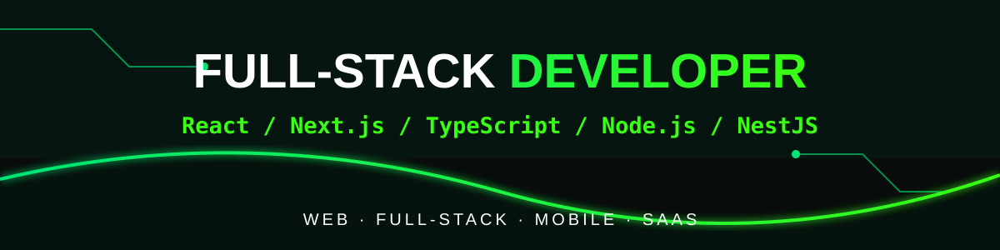

  

# 👋 Hey, I'm Alex Mazur

## **FULL-STACK DEVELOPER**

**React · Next.js · TypeScript · Node.js · NestJS**

Web Applications · Full-Stack Development · Mobile Applications

📍 Lviv, Ukraine | 🌍 Open to Remote Opportunities Across Europe

---

## 👨‍💻 About Me

I'm a Full-Stack Developer based in Lviv, Ukraine. I build web and mobile applications, working across both frontend and backend development.

My main technologies are **React, Next.js, TypeScript, Node.js, and NestJS**. I also work with **PostgreSQL, MongoDB, Redis, React Native, and AWS**.

I'm interested in working with international teams and contributing to product-focused projects. **Open to fully remote opportunities with companies across Europe.**

---

## Key Achievements

- Improved frontend application performance by up to **35%** through code optimization, lazy loading and efficient rendering.
- Reduced API response times by **25%** by optimizing backend logic and database queries.
- Increased development efficiency by **30%** through reusable components and shared code architecture.
- Built and maintained **15+ reusable UI components** across multiple application modules.
- Reduced initial page load time by **40%** through code splitting and asset optimization.
- Integrated **10+ REST API endpoints** and third-party services into full-stack applications.
- Improved application reliability by introducing automated tests and better error handling.
- Delivered responsive interfaces optimized for **5+ screen sizes** and device types.

---
## 🛠️ Skills & Technologies

### 💻 Programming Languages

### 🎨 Frontend Development

### ⚙️ Backend Development

### 🗄️ Databases & Storage

### 📱 Mobile Development

### ☁️ DevOps & Tools

### 📊 Other Skills

---
## Featured Projects

### EventSphere
A web platform for discovering and managing events.
- Built with Next.js, React, TypeScript and Node.js.
- Focused on responsive UI and smooth user experience.

### FitTrack
A mobile fitness application for tracking workouts and progress.
- Built with React Native, Expo and Firebase.
- Includes user authentication and data synchronization.

### TaskFlow
A task management application designed to simplify team workflows.
- Built with React, TypeScript, NestJS and PostgreSQL.
- Focused on task organization and backend functionality.

## 🧭 How I Work

- I prefer clear requirements and practical solutions.
- I care about readable, maintainable code.
- I pay attention to both user experience and technical implementation.
- I value communication, feedback, and continuous improvement.
- I like understanding how a feature fits into the bigger picture of a product.

---

## 📫 Let's Connect

📍 Lviv, Ukraine  
💼 Open to Full-Stack Developer opportunities  
🌍 Interested in remote collaboration
